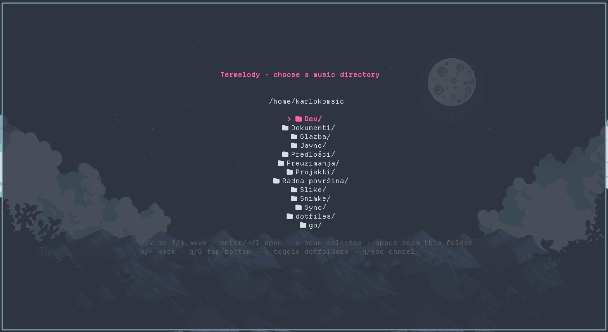
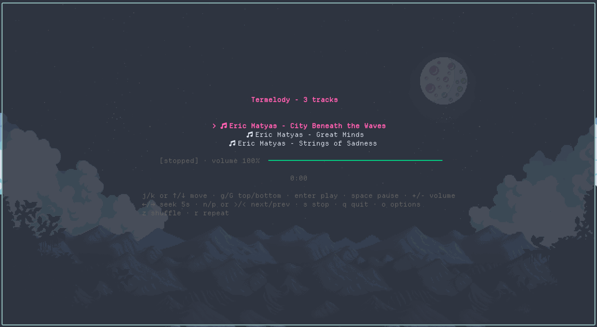

<p align="center">
  
</p>

# Termelody

> [!NOTE]
> The vast majority of the code for Termelody is written by hand. However, I've also gotten help from agents (Opencode, and Pi).
> All the help that I've received from said agents is **thoroughly reviewed, modified, and tested.**
> The architecture, tech-stack, and design choices + tradeoffs are entirely made by myself. Agents only help me write the code faster
> once I've gone over the architecture and design decisions, not do the thinking for me. This code and design is my own, no matter the goods or bads.

A (hopefully) simple, keyboard-driven terminal music player written in Go.

## What this is
Regular music players that usually run through a GUI frankly bore me. It's all "click, click, click" to open a directory and get to the songs I really want to listen. So, I decided, why not expedite this and turn it into something I can use, *in the terminal?* This project is exactly that.
I understand it might not be for everyone, but this project is ultimately something I created for myself, by myself, as an avid terminal user.

With that, Termelody aspires to be a simple enough music player that anyone can launch in the terminal, without any mandatory arguments (CLI options are still welcome, though).

## State of the project
Right now, it's at a solid 1.0, because the basic, main features that a music player should have are included. However, customization options are yet to come, along with some further MPRIS integration, along with many more things to polish this even more.
Currently supported only on *Linux* (any distribution that supports Golang), though compatibility to other platforms might come. Sadly no promises since I've made this project for myself.

## Screenshots

*The folder picker you see on launch*



*The player*



## So, how does it work?
I'm not an expert developer, unfortunately. I use **mpv** as the playback engine and drive it over IPC. Termelody doesn't reimplement audio decoding; it gives you a small, keyboard-driven terminal front end for a player that already does the hard part.

If mpv dies, Termelody relaunches it and resumes the track at its last position, including paused state and volume. It retries three times; if every attempt fails, the error stays on screen and only `q` or `ctrl+c` is accepted.

## Requirements

- [mpv](https://mpv.io) on your `PATH`; Termelody drives it over IPC and does not
  bundle a player of its own.
- Go 1.26.5 or newer, if you build from source.

## Install

Install into a directory that is already on your `PATH`:

```sh
GOBIN="$HOME/.local/bin" go install codeberg.org/karlokomsic/termelody/cmd/termelody@latest
```

`go install` writes to `$(go env GOPATH)/bin` when `GOBIN` is unset. If that
directory is on your `PATH`, the plain form works too:

```sh
go install codeberg.org/karlokomsic/termelody/cmd/termelody@latest
```

Otherwise add it to your shell, for example in `~/.zshrc`:

```sh
export PATH="$PATH:$(go env GOPATH)/bin"
```

To build from a clone instead:

```sh
git clone https://codeberg.org/karlokomsic/termelody
cd termelody
go build -o termelody ./cmd/termelody
mkdir -p "$HOME/.local/bin"
install -m 755 termelody "$HOME/.local/bin/termelody"
```

Verify the binary is on your `PATH`:

```sh
command -v termelody
```

Then run `termelody`, or `termelody ~/Music` to skip the picker.

## Controls

| Key | Action |
|---|---|
| `j` / `k`, `↓` / `↑` | move selection |
| `g` / `G` | jump to top / bottom |
| `←` / `→` | seek back / forward (default 5s) |
| `enter` | play selected track |
| `space` | play / pause |
| `n` / `p`, `>` / `<` | next / previous track |
| `+` / `=` / `-` | volume up / down |
| `z` | toggle shuffle |
| `r` | cycle repeat: off → all → one |
| `o` | open options |
| `s` | stop |
| `q` | quit |

Shuffle plays every track once per cycle before any repeats; `n` and `p` walk
that order too. Repeat `all` wraps at the end of the playlist and repeat `one`
replays the current track. With repeat off, a track that ends on its own stops
at the last track, while pressing `n` still wraps because that is an explicit
choice.

## Usage

```sh
termelody [-seek duration] [-hidden] [-icons set] [-version] [music directory]
```

- `-seek` — how far `←` / `→` jump, e.g. `-seek 30s` (default `5s`)
- `-hidden` — start the folder picker with dot-directories shown
- `-icons` — glyphs before folder and track rows: `unicode` (`🗀` / `♪`;
  standard Unicode, no patched font needed), `nerd` (folder and music glyphs
  from Nerd Fonts, which need a patched terminal font), or `none` (default
  `unicode`)
- `-version`, `-v` — print the version and exit
- With no music directory, a folder picker opens at `$HOME`; only folders are
  listed. Dot-directories are hidden by default; `.` toggles them in the picker.
  Symlinked folders are listed and marked with `@`; broken links and links to
  files are ignored. `s` scans the highlighted folder, `space` the one being
  browsed. Choosing a folder with no supported audio reopens the picker with a
  notice, so another folder can be picked without relaunching.

### Configuration

Termelody reads `termelody/config` from the OS config directory
(`os.UserConfigDir`); on Linux that is `$XDG_CONFIG_HOME/termelody/config`,
usually `~/.config/termelody/config`. The file is optional: without it the
defaults below apply. Command-line flags override values from the file, and the
options screen edits the same file.

The format is one `key = value` per line. `#` starts a comment, either on its
own line or after a value.

```ini
# ~/.config/termelody/config
seek = 5s
icons = unicode
show_hidden = false
volume_step = 1
```

| Key | Default | Meaning |
|---|---|---|
| `seek` | `5s` | how far `←` / `→` jump; uses Go duration syntax such as `10s` or `1m30s` |
| `icons` | `unicode` | row glyphs: `unicode`, `nerd`, or `none` |
| `show_hidden` | `false` | start the picker with dot-directories visible |
| `volume_step` | `1` | percent added or removed by one `+` / `-` press |

Unknown or duplicate keys, and invalid values, are reported with the file and
line at startup rather than silently ignored.

### Options screen

Press `o` while the player is running to edit the preferences without leaving
the terminal:

| Key | Action |
|---|---|
| `j` / `k`, `↓` / `↑` | move between rows |
| `←` / `→`, `enter` | change the selected value |
| `esc`, `q` | close, saving if anything changed |
| `ctrl+c` | quit without saving |

Changes to `seek`, `icons`, and `volume_step` apply immediately. `show_hidden`
is saved for the next folder picker, because the picker runs as a separate
program before playback starts. Saving updates only the four known keys, so
comments, ordering, and other lines in the file survive; a missing file is
created with the current values. Opening and closing the screen without
changing anything leaves the file untouched.

### Picker controls

| Key | Action |
|---|---|
| `j` / `k`, `↓` / `↑` | move selection |
| `enter`, `→`, `l` | open selected folder |
| `h`, `←`, `backspace` | go to parent folder |
| `g` / `G` | top / bottom |
| `s` | scan the highlighted folder |
| `space` | scan the current folder |
| `.` | show / hide dot-directories |
| `q`, `esc` | cancel |

